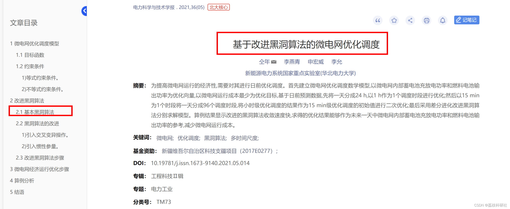
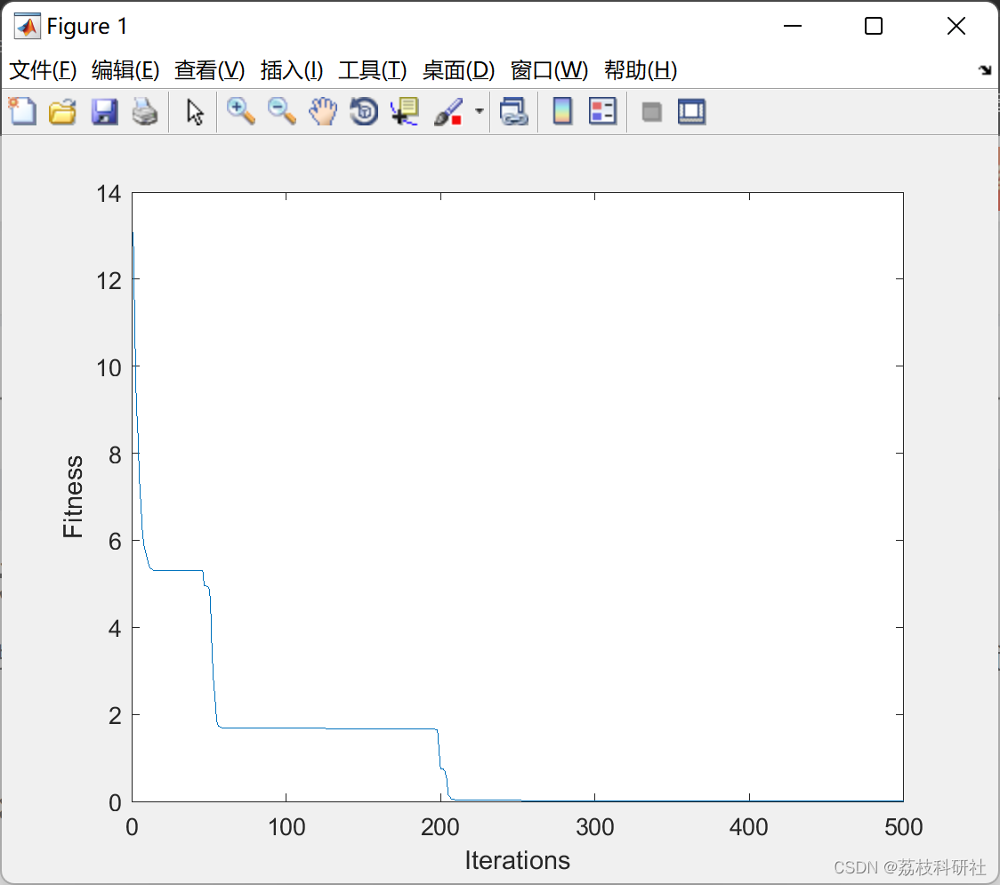

# Black Hole Optimization Algorithm (Matlab Code Implementation)

The Black Hole is a region in space-time, with a very strong gravitational field that cannot be escaped by anything entering it.
References:
Editor
Run results:
Part of the code:
clear all 
clc 
close all 
d=5; % dimension 
options.lk=-32*ones(1,d); % lower bound 
options.uk=32*ones(1,d); % upper bound 
options.m=50; % Size of the population 
options.MAXITER=500; % Maximum number of iterations 
options.n=length(options.uk); % dimension of the problem. 
options.ObjFunction=@Ackley; % the name of the objective function 
options.Display_Flag=1; % Flag for displaying results over iterations 
options.run_parallel_index=0; 
options.run=10; 
if options.run_parallel_index 
% run_parallel 
stream = RandStream('mrg32k3a'); 
parfor index=1:options.run 
% tic 
% index
set(stream,'Substream',index);  
RandStream.setGlobalStream(stream)  
[bestX, bestFitness, bestFitnessEvolution,nEval]=BH_v1(options);  
bestX_M(index,:)=bestX;  
Fbest_M(index)=bestFitness;  
fbest_evolution_M(index,:)=bestFitnessEvolution;  
end  
else  
rng('default')  
for index=1:options.run  
[bestX, bestFitness, bestFitnessEvolution,nEval]=BH_v1(options);  
bestX_M(index,:)=bestX;  
Fbest_M(index)=bestFitness;  
fbest_evolution_M(index,:)=bestFitnessEvolution;  
end  
end  
[a,b]=min(Fbest_M);  
figure  
plot(1:options.MAXITER,fbest_evolution_M(b,:))  
xlabel('Iterations')  
ylabel('Fitness')  
fprintf(' MIN=%g MEAN=%g MEDIAN=%g MAX=%g SD=%g \n',...  
min(Fbest_M), mean(Fbest_M), median(Fbest_M), max(Fbest_M), std(Fbest_M))  
🌈3 Matlab code implementation  
🎉4 References  
[2] Bouchekara, H. R. E. H. (2014). Optimal power flow using black-hole-based optimization approach. Applied Soft Computing, 24, 879–888. doi:10.1016/j.asoc.2014.08.056  
[3]Smail, M. K., Bouchekara, H. R. E. H., Pichon, L., Boudjefdjouf, H., Amloune, A., & Lacheheb, Z. (2016). Non-destructive diagnosis of wiring networks using time domain reflectometry and an improved black hole algorithm. Nondestructive Testing and Evaluation. doi:10.1080/10589759.2016.1200576  
[4] Tong Nian, Li Yanqing, Shen Hongwei, Li Yun. Optimization dispatch of microgrid based on improved black hole algorithm [J]. Journal of Power Engineering Science, 2021, 36(05): 113-119. DOI: 10.19781/j.issn.1673-9140.2021.05.014.

## Images

<!-- PAYMENT_BLOCK -->

## Get this dataset

- Payment link (Stripe): [Buy now](https://buy.stripe.com/3cs8yP7sY87d0vu9AB)
- Payment QR code: 

<!-- /PAYMENT_BLOCK -->
